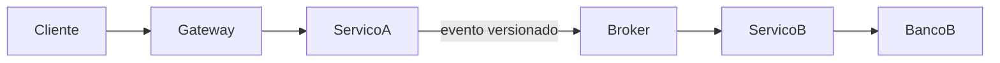

# Template para blueprint macro

O blueprint padrão é `docs/architecture/Project_Architecture_Blueprint.md`. Preserve seções válidas e atualize somente afirmações sustentadas pela análise atual.

## Seções mínimas

1. data, escopo, confiança e fontes;
2. resumo executivo;
3. mapa de sistemas, módulos e componentes compartilhados;
4. ownership dos dados e responsabilidades;
5. matriz de comunicação;
6. diagrama macro de contexto/container;
7. contratos HTTP, eventos, jobs e dependências externas;
8. segurança, resiliência, observabilidade e configuração;
9. build, testes e deployment;
10. divergências, riscos e melhorias priorizadas;
11. questões em aberto e governança do documento.

## Matriz recomendada

```markdown
| Origem | Destino | Responsabilidade da origem | Canal/contrato | Sync | Dados do destino | Ownership | Evidência |
|---|---|---|---|---|---|---|---|
| `servico-a` | `servico-b` | Publica comando/evento | AMQP `evento.v1` | Não | Projeção local | `servico-b` | `arquivo:linha` |
```

## Diagrama recomendado

Use Mermaid somente para relações confirmadas:



Rotule inferências e recomendações fora do diagrama. Não use o diagrama para representar uma arquitetura ideal que ainda não existe.

