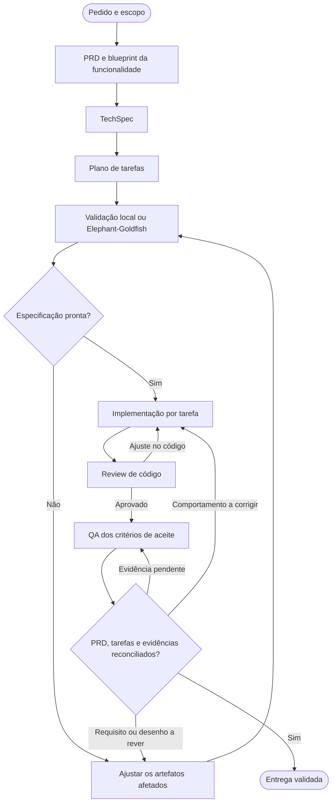

# sdd-java

Kit de **desenvolvimento orientado por especificações (SDD)** para projetos Java e Spring Boot. Reúne regras, skills e templates para transformar uma solicitação em requisitos verificáveis, decisões arquiteturais, tarefas e evidências de aceite.

O [exemplo Spring Boot](example/README.md) acompanha uma API greenfield de reserva de estoque do PRD ao QA. O piloto usa [Elephant-Goldfish](#use-elephant-goldfish) para testar se outro agente consegue interpretar a especificação antes da implementação.

- [Execute o exemplo](#execute-o-exemplo)
- [Conduza o fluxo SDD](#conduza-o-fluxo-sdd)
- [Use Elephant-Goldfish](#use-elephant-goldfish)
- [Skills sob demanda](#skills-sob-demanda)
- [Adote o kit em outro projeto](#adote-o-kit-em-outro-projeto)
- [Valide a entrega](#valide-a-entrega)
- [Licença](#licença)

## Execute o exemplo

Com **Java 21 e Maven**, execute na raiz do repositório:

```text
mvn -f example/pom.xml -B -ntp verify
```

O módulo implementa `POST /reservations`, com saldo e chaves de idempotência em memória durante a vida do processo. A suíte verifica criação, replay, conflitos, entradas inválidas, concorrência e as fronteiras hexagonais. O QA também registra a escuta local e o reinício com o JAR empacotado. [Inicie a API e teste o replay](example/README.md#execute-a-api) · [Arquitetura do exemplo](example/README.md#arquitetura-hexagonal) · [Evidências de QA](example/tasks/prd-reserva-estoque/qa.md)

Para ler a entrega na ordem em que foi construída, siga o [percurso do exemplo](example/README.md#percorra-o-sdd).

## Conduza o fluxo SDD

O fluxograma mostra uma entrega completa. Use o caminho e as etapas autorizadas no pedido. [Contrato SDD](.agents/rules/spec-driven-development.md)



1. **Defina o comportamento.** Registre o problema, o escopo, os RF/RNF e critérios de aceite observáveis. Crie o blueprint junto ao PRD e revise-o quando a mudança for material. Descreva fronteiras e consumidores, compare ganhos e perdas das alternativas relevantes e avalie um ADR para decisões duradouras. Em greenfield, registre lacunas de implementação e premissas. Em um sistema existente, confirme o fluxo e os contratos nas fontes. [Criar PRD](.agents/skills/criar-prd/SKILL.md) · [Gerar blueprint](.agents/skills/architecture-blueprint-generator/SKILL.md) · [Avaliar arquitetura](.agents/skills/avaliar-arquitetura/SKILL.md)
2. **Desenhe e planeje.** Transforme requisitos e decisões em componentes, contratos e verificações na TechSpec. Divida a entrega em tarefas com dependências, critérios de conclusão e IDs estáveis. [Criar TechSpec](.agents/skills/criar-techspec/SKILL.md) · [Criar tarefas](.agents/skills/criar-tasks/SKILL.md)
3. **Verifique a prontidão.** Confira se a especificação permite implementar e testar cada obrigação. Resolva as lacunas que bloqueiam a etapa. Em mudanças de maior impacto, use revisão independente quando solicitada ou autorizada por convenção local. [Validar especificação](.agents/skills/validar-spec/SKILL.md)
4. **Implemente e confirme o aceite.** Parta de `tasks.md` e siga os critérios e decisões da tarefa, incluindo as restrições transversais. Faça review de código, valide o comportamento em QA e percorra `RF/RNF → CA → verificação → tarefa → evidência`. Ao detectar uma divergência, corrija na fonte e revalide os vínculos afetados. [Executar tarefa](.agents/skills/executar-task/SKILL.md) · [Revisar código](.agents/skills/executar-review/SKILL.md) · [Executar QA](.agents/skills/executar-qa/SKILL.md)

Indique ao agente a funcionalidade pelo caminho ou slug e diga até qual etapa ele pode avançar. Por exemplo, “Crie o PRD e o blueprint de reserva de estoque” delimita a descoberta. “Retome a tarefa 2.0 do PRD informado” começa pelo estado da entrega. O contrato SDD define quando cada artefato está `pronto` e o que permite encerrar a funcionalidade. [Contrato SDD](.agents/rules/spec-driven-development.md)

### Onde fica cada informação

```text
tasks/prd-<slug>/
  prd.md             requisitos, escopo e critérios de aceite
  blueprint.md       arquitetura afetada, trade-offs e avaliação de ADR
  techspec.md        desenho, contratos e casos de verificação
  tasks.md           índice, dependências e mapa de cobertura
  task_<n>.md        entrega, verificações e evidências de execução
  spec-review.md     validação dedicada da especificação
  codereview.md      revisão da implementação
  qa.md              resultado do aceite funcional
  evidences/         evidências avulsas quando necessárias
```

Código, build e configuração comprovam o estado atual. O PRD descreve o comportamento esperado e a TechSpec define o desenho. Registre ADRs na convenção do projeto ou em `docs/architecture/adr/`. [Análise de contexto](.agents/rules/project-analysis.md)

### Blueprint por funcionalidade e blueprint macro

- **Funcionalidade** — ao criar ou revisar materialmente um PRD, escreva `tasks/prd-<slug>/blueprint.md` para mapear o impacto no fluxo, nas fronteiras e nos consumidores. Use os trechos pertinentes do mapa macro quando ele existir. [Gerar blueprint da funcionalidade](.agents/skills/architecture-blueprint-generator/SKILL.md)
- **Macro** — crie ou atualize o mapa do projeto ou módulo por pedido explícito ou quando a mudança afetar um blueprint macro adotado localmente. O caminho padrão é `docs/architecture/Project_Architecture_Blueprint.md`. [Procedimento macro](.agents/skills/architecture-blueprint-generator/references/macro-workflow.md)

## Use Elephant-Goldfish

Use uma passagem independente quando uma interpretação diferente puder afetar contratos públicos, consistência de dados, concorrência ou vários módulos. A validação local cobre mudanças delimitadas com o mesmo critério de prontidão.

- **Elephant** — o agente autor mantém o contexto da descoberta e registra as decisões nos artefatos.
- **Goldfish** — um revisor em contexto novo, sem o histórico do autor, recebe apenas a etapa, as revisões das specs, as restrições e as fontes que afetam o escopo. Ele reconstrói o comportamento esperado e aponta ambiguidades ou obrigações sem cobertura.
- **Reconciliação** — o autor confirma os achados nas fontes, corrige os documentos quando autorizado e revalida os critérios e dependências afetados. Consolida a passagem independente no mesmo `spec-review.md`.

Peça a revisão com o caminho exato. Este é um pedido ao agente:

> Use validar-spec em modo Elephant-Goldfish para avaliar a prontidão de implementação em `example/tasks/prd-reserva-estoque/`. Faça uma passagem em contexto novo, somente leitura, e registre achados, evidências e veredito no relatório da funcionalidade.

O modo usa a delegação em contexto novo do ambiente. Se ela estiver indisponível, registre a passagem como `NÃO EXECUTADO` e aplique a checagem local se a etapa permitir. Quando a independência for exigida para liberar a etapa, o veredito fica `BLOQUEADO`. [Procedimento do kit](.agents/skills/validar-spec/references/elephant-goldfish.md) · [Modelo EGM](https://github.com/google/elephant-goldfish-model)

**O que o piloto demonstrou.** O revisor identificou três lacunas materiais e uma ambiguidade no formato da quantidade antes do código. Uma delas era a prova do saldo exato. Confirmar uma reserva final de quatro unidades provava apenas que havia pelo menos quatro. O plano passou a exigir a rejeição de cinco seguida da confirmação de quatro. Ganhos de tempo, retrabalho e tokens ainda precisam de comparação controlada. A revisão posterior do código levou à adoção do perfil hexagonal, hoje verificado no build. [Relatório do piloto](example/tasks/prd-reserva-estoque/spec-review.md) · [Como avaliar](example/README.md#avalie-a-revisão-independente)

## Skills sob demanda

### Por pedido explícito

- **`criar-commit`** prepara a mensagem ou cria um commit local no padrão Conventional Commits quando solicitado. Use `--dry-run` para simular com o conteúdo staged ou `--files` para delimitar a seleção. [Skill de commit](.agents/skills/criar-commit/SKILL.md)
- **`caveman`** aplica estilo telegráfico quando você pede esse modo pelo nome. Preserva a redação necessária para especificações, contratos e evidências. [Skill de estilo](.agents/skills/caveman/SKILL.md)

### Conforme o escopo

Carregue estas skills quando a atividade correspondente fizer parte do pedido ou da etapa em execução.

- **Diagnóstico de projeto** — use `project-context-analyzer` para onboarding ou análise entre módulos. Gere release de contexto quando esse registro for solicitado ou adotado. [Analisar contexto](.agents/skills/project-context-analyzer/SKILL.md)
- **Código Spring Boot** — use `spring-boot-conventions` para APIs, beans, configuração e integrações conforme as versões do módulo. [Convenções Spring Boot](.agents/skills/spring-boot-conventions/SKILL.md)
- **Testes** — use `java-junit` para lógica Java isolada e `springboot-test` quando o comportamento depender do Spring ou de infraestrutura. [JUnit](.agents/skills/java-junit/SKILL.md) · [Testes Spring Boot](.agents/skills/springboot-test/SKILL.md)
- **Contratos OpenAPI** — use `openapi-contract-first` para evoluir um contrato OpenAPI versionado e sua geração de código. [Contrato OpenAPI](.agents/skills/openapi-contract-first/SKILL.md)
- **Verificação arquitetural automatizada** — use `archunit-rules` para verificar fronteiras e dependências previstas na arquitetura adotada. [Regras ArchUnit](.agents/skills/archunit-rules/SKILL.md)

## Adote o kit em outro projeto

1. Integre o [AGENTS.md](AGENTS.md) às instruções do repositório de destino. Preserve as convenções e instruções dos módulos.
2. Copie as [regras](.agents/rules/) e [skills](.agents/skills/) que serão usadas. O guia do projeto indica quando carregar cada regra ou skill.
3. Preencha `.agents/project/profile.md` com os módulos, versões, arquitetura, contratos e comandos confirmados no destino. Registre critérios locais de revisão independente se a equipe os adotar. [Modelo de perfil](.agents/project/profile.example.md)
4. Comece por uma funcionalidade pequena e compare o resultado com o [exemplo](example/README.md) e os [cenários de avaliação](docs/sdd-validation.md).

## Valide a entrega

Com Python 3.10 ou superior, execute na raiz:

```text
python scripts/validate_structure.py
python -m unittest discover -s scripts/tests -v
```

Esses checks cobrem metadados das skills e links locais do kit. Para verificar a API, rode a suíte Maven do exemplo. Para avaliar o comportamento da LLM, compare achados válidos, falsos positivos, tempo e tokens totais usando os mesmos artefatos de entrada. [Roteiro de avaliação](docs/sdd-validation.md#comparação-entre-versões-do-kit)

## Licença

Este repositório é distribuído sob a **Apache License 2.0** (`Apache-2.0`). [Leia o arquivo LICENSE](LICENSE)
